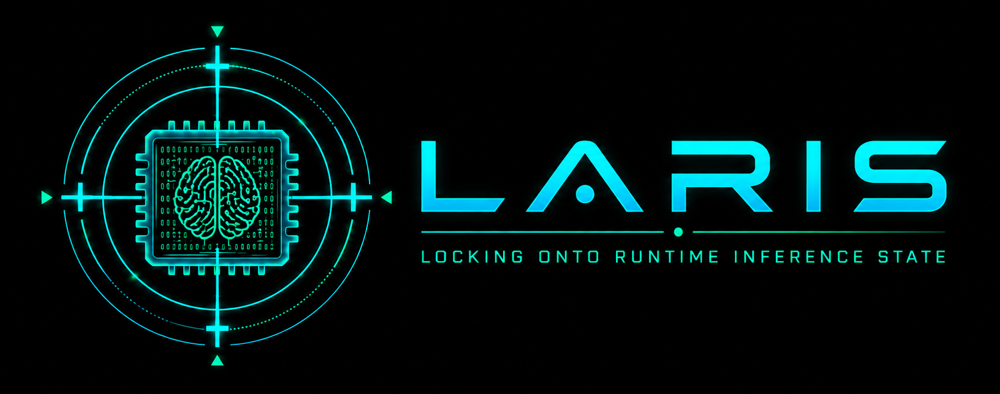

<h1 align="center">LARIS</h1>

<h3 align="center">
  LARIS: Attribution-Aware Selective KV-Cache Acquisition and Rehosting<br>
  for Investigative Querying in Shared LLM Services
</h3>

<p align="center">
  
</p>

<p align="center">
  
  
  
  
  
  <br>
  
  
  
  
</p>

<p align="center">
  
</p>

## Overview

**LARIS (Lock-on Acquisition of Runtime Inference State)** is an on-premises forensic
framework for selectively acquiring KV-cache state from shared local LLM services,
attributing that state to the corresponding user or request context, sealing it as
verifiable evidence, and rehosting it for subsequent investigative querying. Rather
than capturing an entire process image, LARIS targets runtime memory windows associated
with inference state and preserves the metadata required to interpret and verify the
acquired state.

LARIS provides two attribution paths. Proxy mode binds captured state to an
authenticated request identity, while Log-linked mode correlates runtime endpoints
with external request records. In both paths, acquisition, attribution, sealing, and
rehosting remain explicit evidence stages. Captures are bound to process identity,
protected by integrity metadata, and replayed in a fresh runtime instead of restoring
the original serving process.

This repository contains the current implementation, evaluation protocols and results,
verification tests, and reproduction tools. The curated Evaluation1 KV release is
documented in the
[Evaluation1 release metadata](evaluation/publication/releases/evaluation1-release-v1/README.md),
which provides the GitHub entry point for the verified bundle inventory, download
locations, license notices, and replay instructions.

## Attribution modes

| Mode | Evidence boundary | Public replay selector |
|---|---|---|
| Proxy | Authenticated user identity | checkpoint and public user reference |
| Log-linked | Runtime endpoint correlation | checkpoint and public user reference |

Both modes bind observations to the target process by PID/start ticks and reject stale
process reuse. Sealing, digest verification, attribution, and rehosting remain separate
from model generation.

## Getting started

1. Follow [the quickstart](docs/QUICKSTART.md).
2. Prepare a new replay machine with the [public rehosting setup](docs/REHOSTING_SETUP.md).
3. Read [the Evaluation1 replay guide](docs/reproducibility/evaluation1-release.md).
4. Use the [operator guide](docs/OPERATOR_GUIDE.md) for live Proxy and Log-linked operation.
5. Inspect the published [attribution and recall results](evaluation/results/attribution-accuracy-and-cross-user-isolation/comparison.md).
6. Inspect the completed [Evaluation2 overhead results](evaluation/results/runtime-overhead/README.md).

Small, independently verifiable Evaluation1 metadata is tracked under
`evaluation/publication/releases/evaluation1-release-v1`. The seven externally hosted
files are downloaded into the ignored directory
`evaluation/publication/external/evaluation1-release-v1` and are accepted only after
their exact paths, sizes, and SHA-256 digests pass offline verification.

## Installation

From the repository root:

```text
python -m pip install -e .
```

Native capture requires the Linux toolchain and kernel facilities described in the
operator documentation. Rehosting also requires a compatible runtime and separately
obtained GGUF weights. The repository does not redistribute model weights.

## Repository map

- `src/laris_onpremise/`: capture, attribution, sealing, and reproduction code
- `native/`: native observer and rehosting components required by the current system
- `configs/`: current runtime profiles and schemas
- `schemas/`: public machine-readable contracts
- `evaluation/`: Evaluation1 and Evaluation2 protocols, metadata, and results
- `tools/`: current operator and VM helpers
- `docs/`: quickstart and Evaluation1 reproduction documentation
- `tests/`: unit, contract, and integration verification

This public release intentionally omits the interactive UI, repository-host
automation, removed legacy checkpoint backends, local work records, VM disks, model
weights, and private host artifacts. The native directory is retained because it is the
implementation boundary for eBPF observation and KV rehosting, not a generated result.

## Verification

```text
python -m pytest tests/unit/reproduction tests/contract/test_evaluation_publication_docs.py
python -m compileall -q src evaluation/scripts
```

Artifact verification and replay commands are defined in the quickstart and the
Evaluation1 release guide.

## License

Copyright 2026 LARIS Authors.

LARIS source code is licensed under the
[Apache License 2.0](LICENSE). Third-party models, model-derived artifacts, and
external evaluation bundles remain subject to their respective terms. See the
[evaluation license notices](evaluation/publication/LICENSES.md) for details.
